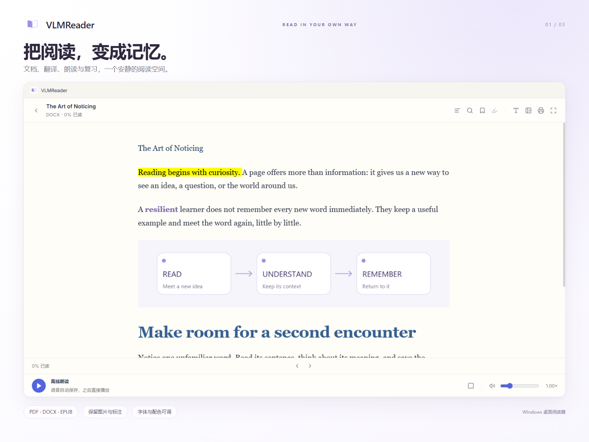
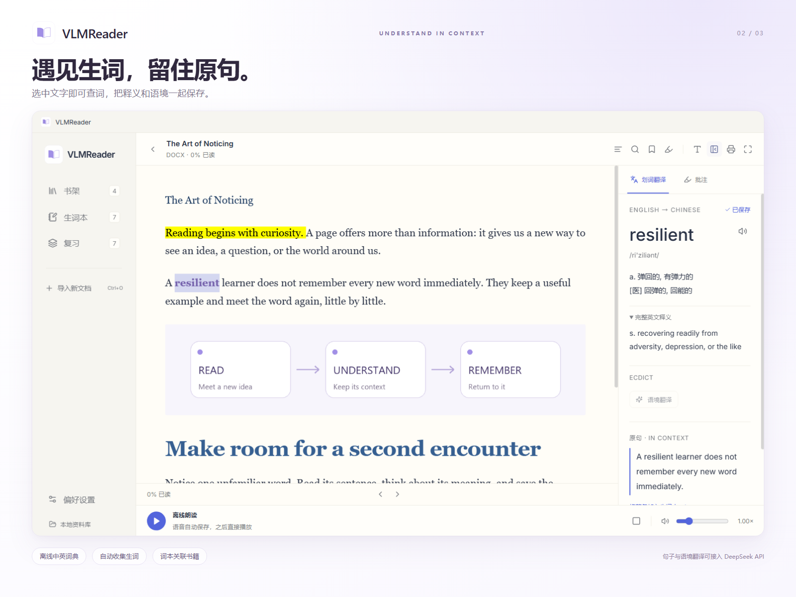
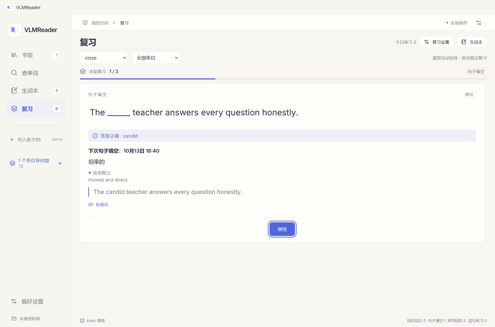

# VLMReader

Windows 阅读器：本地文档、离线词典、双语朗读、批注与间隔复习。支持简体中文 / English。

## 读懂，记住，再遇见

VLMReader 是一款面向双语阅读与学习的 Windows 阅读器，支持 PDF、DOCX、EPUB 等常见格式。划词即可查询离线中英词典，生词连同释义和原句保存；句子与语境翻译可接入 DeepSeek API。配合双语离线朗读、批注、词本分区和 FSRS 间隔复习，让阅读中遇见的知识慢慢留下来。字体、字号和配色自由调整，文档与学习记录保存在本机。





## 启动

**安装版：**从 [GitHub Releases](https://github.com/XKRyan/VLMReader/releases/latest) 下载 `VLMReader-Setup-0.5.4-x64.msi`，双击按向导安装，可选择目录。默认优先使用 `D:\VLMReader`，没有 D 盘时使用当前用户的应用目录。安装后可通过桌面或开始菜单启动，在 Windows“已安装的应用”中卸载。离线词典和语音模型已包含，安装时无需另外下载。

安装版和便携版使用相同的 `data` 资料目录。选择原便携版根目录即可延续已有资料，安装前请先退出阅读器。安装与覆盖升级不改写 `data`；卸载保留文档、生词、批注、设置和语音缓存，也保留安装目录中与程序无关的文件。

**便携版：**

从 [GitHub Releases](https://github.com/XKRyan/VLMReader/releases/latest) 下载 `VLMReader-0.5.4-windows-x64.zip`，完整解压后双击 `VLMReader.cmd`。发布包已包含离线词典和语音模型，无需另行下载；请保留 `release\win-unpacked` 的文件夹结构，个人资料会保存在解压目录下的 `data`。

双击 `VLMReader.lnk`，或运行 `release\win-unpacked\VLMReader.exe`。程序无需安装。不要单独移走 exe；它需要同文件夹中的资源。首次启动可阅读欢迎文档。

## 使用

- 导入 PDF、EPUB、DOCX、TXT、Markdown 或 HTML；支持拖入文件、搜索、目录、阅读进度、收藏、书签与打印。PDF 原版和文字模式均连续滚动，各页自然衔接，跨页不会跳到页首；EPUB 支持滚轮翻页。
- DOCX 保留原有荧光笔颜色、文字颜色、文字底纹、粗体、斜体、下划线、表格和嵌入图片；支持段落 / 字符样式继承及主题色。已经导入的 DOCX 直接打开即可使用，无需重新导入，也不会改动源文件。HTML / Markdown 保留文字颜色、标注及图片，导入时将同目录及子目录内引用的图片一起保存；已有 HTML / Markdown 可重新导入同一文件补全图片，不会重复建书。EPUB 与原版 PDF 保留其原始颜色和图片。PDF 文字模式重排正文，并尽量保留图片、矢量图、文字颜色和荧光笔标注，包括独立 Highlight 批注和已画进页面的色块；改变字体及字号后标注仍跟随对应文字。图片按原页渲染，保留旋转、透明度、遮罩及图内标签，邻近正文保持可选取；只在接近可见区域时提取，同一本书阅读期间切换字体或模式直接复用。已导入的 PDF 直接打开即可，无需重导入，也不会改动源文件。
- 鼠标选中词或句子，右侧显示译文；不会自动保存。点击“加入词本”后才收录释义和原句，句子也只手动保存。单一关联词本会默认选中，多个关联词本需先选择目标；也可以选择其他词本或未归类。悬停查词同样不会自动收集。
- 选中文字后点击“添加批注”，保存高亮和自己的理解。批注侧栏支持定位原文、编辑与删除；跨重启保留，删除不改动文档内容。
- 英汉查询使用 ECDICT，汉英查询使用 CC-CEDICT；保留完整词条与英文释义。专业词、短语或词典未收录的内容可使用 API。
- 句子翻译在“偏好设置 → 翻译服务”填写 DeepSeek API 密钥后启用。默认模型名为 `deepseek-flash`，接口地址和模型名称可修改。密钥使用 Windows 加密存储，不会出现在资料导出文件中。
- 底部播放按钮朗读当前页面或章节；右侧扬声器朗读所选内容。支持暂停、停止、0.50–3.00 倍连续调速并保持音高，默认自动接续下一页或章节。Kokoro 在本机生成语音，无需下载每段音频；英文数字按英文发音。阅读时后台提前准备语音，首次播放短暂缓冲，句子共享连续音轨。完成的音轨永久保存在 `data\audio`，退出或重启后直接复用；改变倍速不重新生成。停止播放后可在后台完成缓存，提前退出时已完成句子也会保留。96 kbps 单声道 MP3 约 0.7 MB / 分钟，一小时约 43 MB；完整音轨保存后去除重复的临时句子文件。
- 左侧“查单词”支持中英查询，优先使用离线词典；未收录时由 DeepSeek 以音标、词性、释义和英文解释的固定格式补全，AI 来源明确标注。例句仅点击“生成 AI 例句”后生成，查询结果可以选择词本保存。AI 内容可能有误，可编辑校正。
- 生词本的“添加单词”可以单独输入中英文词语，由离线词典自动补全释义，再保存可选原句，无需 API。词典未收录时可手动填写释义。
- 生词本可以编辑完整译文、查看原句、回到来源、补译句子、暂停复习和导出 CSV/JSON。默认每页 20 条，可改为 10 或 50 条并记住选择；工具栏固定，只有列表及详情内容滚动。“未复习”是实时更新的系统词本，首次完成练习后移出。点击“管理”后显示选择框和删除按钮；表头复选框全选当前页，换页、搜索或筛选会清空选择。确认删除时同时移除所选条目及其复习记录，取消则保留。管理模式也支持单独删除。
- “新建词本”可以分区收藏，并关联书架中的多本书。手动加入新词时可选择目标词本，同一词可以属于多个词本。创建或编辑时可选择“同时收录已有生词”。管理模式可批量移入或移出词本；删除词本只移除分组，保留词条及复习记录。导出和复习支持按词本筛选，JSON 备份保留词本关联。
- 单词复习统一为混合队列，在“偏好设置 → 复习习惯”选择开启词义、句子填空、拼写。每种能力各有独立的 FSRS 记录与到期时间，优先安排到期、重学及薄弱能力；未练过的题型至少隔 20 分钟引入，同一轮每个词只出现一次。关闭题型保留其进度，重新开启后继续。旧版进度只迁移到最近练过的题型，另外两种从未复习开始。词义、拼写及整句关键词练习保留手动评分，FSRS 默认目标保持率 90%。
- 单词“句子填空”先使用可用原句，原句答对后改用 DeepSeek 新例句；没有原句时直接生成。每次新的练习优先换句，约 20% 抽取旧例句，避开最近两题，优先复习曾答错的句子。每词保留最多 12 条例句，未作答题目及提示进度重启后继续。原词答对按 Good、错误按 Again 自动安排下次时间；提示分为“中文释义 → 首字母 → 揭晓并计为不会”，用提示答对按 Hard 安排。空白、API 错误或保存失败不计作答。生成例句需要 DeepSeek 密钥，原句练习可离线进行。
- 填空中选择不认识的词可以查词，离线词典优先，点击“加入词本”才保存；默认加入专用的“句子填空”词本，也能选择其他词本。符合当前句意、语法及搭配的同义替代答案单独标为“不计对错”，不改变熟练度，10 分钟后补测目标词。先复用出题时的候选与判定缓存，明显无效答案本地判断，仅必要时使用简短 API 判定；API 失败不擅自记错。
- 四种阅读主题，每种都可独立调整主题色、界面背景、阅读底色及正文文字颜色；提供预设、色值输入、即时预览和恢复默认。应用边框、导航及底部播放器固定，只有内容区滚动。字号、行距、宽度与字体可调。偏好设置中分别选择“界面字体”和“正文字体”，可输入已安装字体的名称。DOCX、EPUB、TXT、Markdown 和 HTML 使用正文字体。PDF 顶部点击“文字模式”可修改字体和字号，同时保留可识别的图片和标注；“原版 PDF”保留原布局与原字体。文字模式无法保证复杂公式、重叠图形、表格或多栏版式完全还原，此类页面可切回原版；图片或图表中的文字保持原图字体。扫描页及没有可提取文字的页面保留完整原图，改字体、划词和朗读仍需先 OCR。设置中可即时切换简体中文 / English，语言选择会保存。

“偏好设置 → 阅读外观 → 界面字号”可调导航、按钮与面板文字，范围 13–22px，默认 16px，关闭后会记住。正文字号单独设置；原版 PDF 保留原字体与取词位置。配色修改立即作用于界面并自动保存，快速离开设置页也会保存；每种阅读主题独立记录配色。

快捷键：Ctrl+O 导入、Ctrl+F 文内搜索、Ctrl+Space 暂停 / 继续朗读、F11 全屏；复习时 Space 显示答案，1–4 评分。

## 数据与限制

个人资料位于 `data`。`data\books` 存放导入的文档副本，`library.json` 存放进度、生词与复习记录。移除书架文档不影响原始文件和已收集的生词。

“立即备份”和 JSON 导出保留阅读记录与生词；迁移全部文档时请复制整个 `data` 文件夹。加密 API 密钥跨电脑需要重新填写。

扫描 PDF 可以查看，但需要先经过 OCR 才能划词、搜索或朗读。旧版 `.doc`、DRM 加密电子书及复杂 Word 版式不在当前支持范围；DOCX 按阅读版式显示。打印功能打印当前可见文档视图。离线词典不替代上下文翻译；没有有效 API 密钥时可手动保存为待翻译，之后补译。

词典、模型、依赖许可和研究链接见 `assets\ATTRIBUTION.txt` 及随程序附带的许可文件。

## 开发与验证

需要 Windows x64、官方 Node.js 24、pnpm 和 Python 3.12+。源码仓库不包含大词典、模型、运行时、构建产物或个人资料。首次构建：

```powershell
pnpm install
python scripts/prepare_assets.py
node scripts/prepare_runtime.cjs
pnpm build
pnpm start
pnpm package
pnpm installer
```

资源准备只需首次执行，之后复用本地文件。默认打包将白紫书本图标及 VLMReader 名称写入 EXE 文件，验证七种图标尺寸与官方运行时代码一致，不再恢复 Electron 图标。Rollup 使用官方 WASM 包。

当前品牌版本未进行发布签名，启用智能应用控制的电脑可能阻止它启动。需要签名时，先运行 `pnpm package:prepare-signing`，使用受信任的代码签名证书或服务签名 `publication/signing/VLMReader.exe`，将 `VLMREADER_SIGNED_EXECUTABLE` 设为签名后的文件路径再运行 `pnpm package`；打包程序验证图标、运行时代码与签名，验证失败立即停止。`VLMREADER_REQUIRE_SIGNATURE=1` 可强制要求签名；`VLMREADER_COMPATIBILITY_EDITION=1` 可显式构建保留官方 Electron 图标的兼容版本。构建流程不修改 Windows 安全策略，也不导入自签名信任证书。

`pnpm installer` 使用 Windows Python 3.12 的 msilib 和 Windows Installer，将已构建的 `release/win-unpacked` 制作为 MSI 安装包，输出到 `publication`；MSI 不运行额外的 EXE 自定义安装动作。`node tests/installer-smoke.cjs --msi` 在独立安装目录验证安装、完整文件校验、应用启动、离线查词与朗读、覆盖升级和卸载保留资料；使用独立的测试快捷方式和注册项，不会修改现有阅读器资料。可通过 `VLMREADER_PYTHON` 指定 Python 3.12 路径。

`node tests/upgrade-ui.cjs` 验证分页与局部滚动、未复习词本实时更新、独立题型设置、三级提示、同义词中性判定、填空查词及专用词本、按钮居中、即时配色与重启保存、中英文及小窗口大字号。`node tests/cloze-lookup-ui.cjs` 验证自动判题、原句进度、AI 词典、按需例句、选择词本与手动划词保存。运行 `pnpm test` 检查词典、资料持久化、独立 FSRS 与迁移、翻译、文档格式、PDF 重排与持久语音缓存；其他文档、批注、连续滚动、语音及安装测试位于 `tests`。界面测试使用独立资料夹，不会写入个人资料；可设置 `MEMREADER_EXE` 测试打包程序。合成测试文档可通过 `scripts/create_fixtures.py`、`scripts/create_formatting_fixtures.py` 或 `scripts/create_pdf_reflow_fixture.py` 生成（需要 reportlab、pypdf、python-docx 和 Pillow）。

## 许可与公开发布

项目代码使用 MIT 许可。第三方字典、模型和依赖保留各自许可，见 `assets/ATTRIBUTION.txt` 和随程序提供的许可证与源代码包。公开发布只包含程序及合成测试文档，不包含个人阅读资料、音频缓存、密钥或日志。
