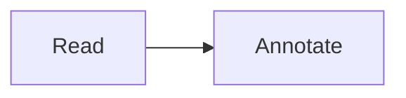
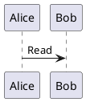

# Complete Markdown

[TOC]

## Basics

A **thoughtful reader** keeps notes. ~~old~~ ==highlight== ++added++ H~2~O x^2^ :smile:

- [x] Completed
- [ ] Pending

| Left | Center | Right |
| :--- | :---: | ---: |
| reading | science | math |

> [!NOTE]
> Important reading guidance.

Term
: Its definition.

{+inserted+} and {-removed-}.

<kbd>Ctrl</kbd> + <kbd>K</kbd>

[Go to 中文](#中文标题) · [Second document](../Second.md#linked-section) · [External site](https://example.com/reading)

Footnote reference[^one].

[^one]: A footnote explanation.

Inline formula $E=mc^2$ and \(a^2+b^2=c^2\).

$$
\int_0^1 x^2 dx = \frac{1}{3}
$$

```math
\begin{pmatrix}a&b\\c&d\end{pmatrix}
```

```js
const answer = 42;
```

.png>)




```sequence
Title: Reading sequence
Reader->Book: Open
Book-->Reader: Text
```

```flowchart
st=>start: Start
e=>end: End
st->e
```

```vega-lite
{"data":{"values":[{"label":"A","value":2},{"label":"B","value":5}]},"mark":"bar","encoding":{"x":{"field":"label","type":"nominal"},"y":{"field":"value","type":"quantitative"}}}
```



## 中文标题

Anchor target paragraph.

### Repeated

First repeated.

### Repeated

Second repeated.

#### Fourth

##### Fifth

###### Sixth

<script>window.markdownUnsafe=true</script>


[Unsafe](javascript:alert(1))

$$
\notARealCommand{broken}
$$
